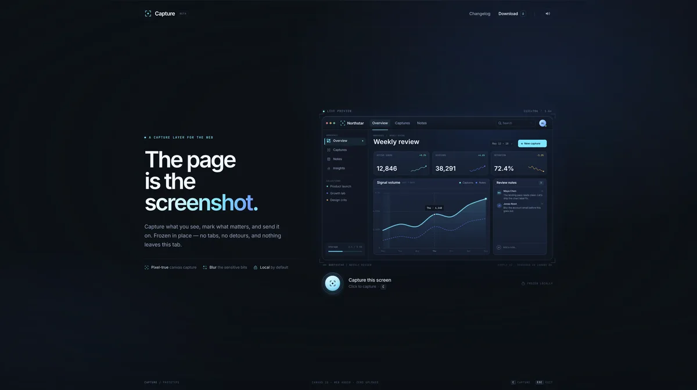

# Capture — the page is the screenshot (prototype)

A one-screen landing page for a screenshot-and-annotation tool whose demo captures itself. The product preview is drawn in Canvas 2D; pressing the shutter turns that live drawing into a frozen bitmap, then lets you select, annotate, and export it without leaving the page.



This is an original prototype built around a few principles: static-first, one signature interaction, a physical metaphor, and sound only after a gesture. No third-party assets, code, or audio are used.

## Run it

```bash
npm install
npm run dev
```

Open the URL Vite prints (defaults to `http://localhost:5173`). Build the production bundle with:

```bash
npm run build
```

## Use it

- **Shutter / `C`** — freeze the live preview.
- **Drag on the frozen image** — make a selection. Drag any of the eight handles to resize it.
- **`V` / `A` / `R` / `B`** — select, arrow, box, and blur tools. Click a tool in the floating toolbar instead if you prefer.
- **Copy** — writes a PNG of the selection (or the whole capture) to the clipboard. If the browser blocks image clipboard access, Capture downloads the PNG instead and says so.
- **Download** — saves the selected crop as a PNG.
- **`Esc` / Reset / Exit** — throw away the capture and return to the live preview.
- **Header sound toggle** — mute the synthesized shutter and copy chime. The preference is remembered locally.
- **Changelog** — opens the in-page release notes dialog.

On a phone the toolbar becomes icon-only. The canvas keeps touch dragging, the layout stacks, and the page still fits a 390 × 844 viewport.

## What is implemented

- A static landing page with a dark navy / ice-blue identity, a subtle grid, Inter and JetBrains Mono, and an SVG crop-mark brand.
- A fully canvas-rendered fictional analytics app, **Northstar**: window chrome, sidebar, metrics cards, a smoothed signal chart with tooltip and live endpoint, review notes, and a responsive compact layout. It has a capped ~30 fps ambient animation: a breathing endpoint, a `LIVE` pulse, and a quiet chart scan.
- A real capture pipeline. The live canvas pixels are copied at device resolution into an offscreen frozen bitmap. The live canvas fades out while the snapshot fades in under a shutter flash and stage kick.
- A frozen-image editor:
  - Dimmed capture, drag-to-select rectangle, dimension tag, and eight resize handles.
  - Arrow, box, and pixel-blur annotations. Blur is a downsample/upscale mosaic from the frozen bitmap.
  - Copy and Download draw from the original frozen pixels at native resolution (not from the scaled display canvas).
  - If a selection exists, exports are cropped to it; annotations are composited first.
- Synthesized audio with the Web Audio API: a mechanical shutter made from noise and oscillator envelopes, a soft three-part copy chime, and a low error tone. No audio files. The AudioContext is created inside a user gesture.
- Toasts for copy/download success and clipboard failure; an `aria-live` region announces capture, selections, and annotations.
- Keyboard and focus handling: the shutter is a real button, `C` starts capture, `Esc` exits, tool shortcuts work, `Escape` is advertised, and the toolbar supports arrow-key navigation.
- Reduced-motion support: no flash, shake, or entrance animations; the freeze is a simple fade and all selection tools still work. The live preview becomes a static frame.
- Paused animation: the preview RAF loop stops when the tab is hidden, the canvas leaves the viewport, or the capture is frozen. CSS pulses pause with it.
- Responsive layout at 1280 × 800 and 390 × 844, with a compact canvas layout on phones and a wrapping toolbar.

## How it works

| File             | Role                                                                                                                                  |
| ---------------- | ------------------------------------------------------------------------------------------------------------------------------------- |
| `src/preview.ts` | The canvas-drawn Northstar app and its visibility-aware animation loop.                                                               |
| `src/editor.ts`  | Capture state, normalized selection geometry, annotation drawing, mosaic blur, and native-resolution PNG composition.                 |
| `src/audio.ts`   | The Web Audio shutter, chime, and error sounds, plus mute state.                                                                      |
| `src/main.ts`    | DOM wiring, shutter/reset flow, clipboard and download handling, toasts, dialog, keyboard shortcuts, and accessibility announcements. |
| `src/style.css`  | The layout, identity, physical shutter, crop marks, glass toolbar, responsive rules, and reduced-motion treatment.                    |

Canvases are sized in CSS pixels but backed by DPR-scaled bitmaps (capped at 2.5×) so text and chart lines stay crisp. Annotations use normalized coordinates, so they survive viewport changes; the source bitmap stores the capture at native resolution. The display is a composition of the frozen image, a dimming veil, the selected cutout, annotations, and selection chrome. Export skips the veil and chrome and instead paints the frozen image plus annotations into a clean offscreen canvas.

Fonts are loaded from Google Fonts with system fallbacks. There are no external image or audio files; the app preview, icons, crop marks, and sounds are generated by code.

## Rough edges and next steps

- Resizing the browser during a capture stretches the frozen bitmap to the new stage aspect. A nicer path would letterbox the snapshot or preserve its aspect through a rotate/resize.
- There is no undo/redo for annotations; Reset discards the whole capture. A per-mark undo stack would be the first editor addition.
- Text callouts, movable/resizable annotations, and a color choice would round out the annotation set.
- Copy depends on the Async Clipboard API and a secure context. The fallback download path is implemented, but Safari/Firefox clipboard behavior varies.
- The desktop `Download` nav item is intentionally a placeholder toast for now.
- True full-page/OS capture would be a separate feature; this prototype deliberately captures its own canvas, which keeps the demo self-contained.
- A small `?test` hook and a poster/screenshot generator would make automated visual checks easier.

## Notes

The prototype lives in the `capture` worktree on the `capture` branch. The concept brief is in [`CONCEPT.md`](./CONCEPT.md). No dependencies beyond Vite and TypeScript; no React, animation libraries, or image/audio assets.
